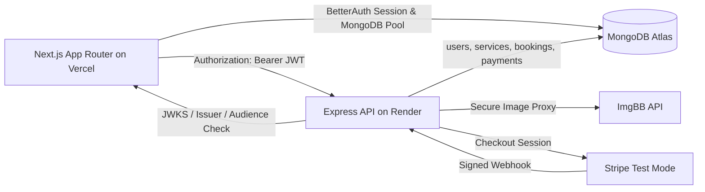

# FixMate — Smart Device & Home Appliance Repair Service Platform (Client)

**FixMate** is a full-stack, role-based on-demand device and home appliance repair service booking platform. It gives customers transparent, step-by-step repair tracking with **pay-after-completion** security, while giving skilled technicians a structured workspace to publish services and manage incoming repair jobs under admin moderation.

---

## Live Links & Repositories

- **Live Website (Vercel):** https://fixmate-client-inky.vercel.app
- **Live Backend API (Render):** https://fixmate-server-65ai.onrender.com
- **Client Repository:** https://github.com/abukausar-dev/fixmate-client
- **Server Repository:** https://github.com/abukausar-dev/fixmate-server

> **Note:** The Express backend runs on Render's free tier, so the first API request after inactivity may take 30–50 seconds to wake up.

---

## Admin & Demo Credentials

| Role | Email | Password | Dashboard Route |
| :--- | :--- | :--- | :--- |
| **Admin** | `<admin@fixmate.com>` | `<Admin123>` | `/dashboard/admin` |
| **Technician** | `<technician@gmail.com>` | `<Tech123>` | `/dashboard/technician` |
| **Customer** | `<meheraabarvy@gmail.com>` | `<Mehe123>` | `/dashboard/customer` |

**Stripe Test Card (Test Mode):** `4242 4242 4242 4242` · Any future expiry (e.g., `12/29`) · Any 3-digit CVC.

---

## Key Features

### Public & Discovery Experience
- **Responsive UI & Theming:** Sticky navbar with active route highlighting and mobile hamburger menu, Light/Dark theme toggle, custom loading skeletons, repair-themed 404 Not Found and error boundary pages, toast notifications, and friendly empty states.
- **Dynamic Home Page:** Hero banner, latest 6 approved & available featured services, 4-step *How FixMate Works* workflow, and 7 clickable repair categories (`Smartphone`, `Laptop & PC`, `AC`, `Refrigerator`, `TV`, `Washing Machine`, `Electrical`).
- **Server-Side Search, Filter & Sort (`/services`):** MongoDB-backed keyword search, category and service mode (`Home Visit` / `Shop Drop-off`) filters, and sorting (`Price: Low to High`, `Price: High to Low`, `Newest`) synced with URL query parameters so filters persist after reload.

### Authentication & Role-Based Security
- **BetterAuth + MongoDB Adapter + JWT:** Email/password registration and login with password validation (minimum 6 characters, at least one uppercase and one lowercase letter), reload-safe private sessions, and short-lived (`15m`) JWT issuance for Express API verification.
- **Role Escalation Prevention:** Public registration allows only `customer` or `technician`; `admin` signup is blocked on both frontend and server (`databaseHooks`).
- **Server-Side Role Guards:** Dashboard layouts verify authentication and role on the server, redirecting unauthenticated users to `/sign-in` and blocking cross-role dashboard access.

### Role-Based Dashboards
- **Customer Dashboard (`/dashboard/customer`):** Overview stats and charts, booking tracker with consistent status/payment badges, cancellation confirmation while `requested`, duplicate active-request prevention, Stripe Checkout **Pay Now** only for `completed` + `unpaid` jobs, and full payment receipt history.
- **Technician Dashboard (`/dashboard/technician`):** Overview stats, service submission with ImgBB file upload (starts as `pending`), full CRUD management (editing resets `approvalStatus` to `pending`, delete confirmation modal, live availability toggle), and one-step job pipeline controls (`Requested → Accepted / Rejected → In Progress → Completed` with final amount modal).
- **Admin Dashboard (`/dashboard/admin`):** Platform overview stats and charts, user role management (self-role change blocked), service approval/rejection queue, platform-wide bookings monitor, and Stripe transactions table with total revenue.
- **Shared Profile Page (`/dashboard/profile`):** Update name, phone, area, bio, and ImgBB avatar with immediate sync in the navbar and dashboard top bar without logging out.

---

## System Architecture



---

## Packages Used (Installed via pnpm)

> *Update any extra UI, chart, or toast packages below to match your exact `package.json`.*

| Package | Purpose |
| :--- | :--- |
| `next` | Next.js 16 App Router framework (SSR, routing, API routes) |
| `react` / `react-dom` | Component rendering |
| `typescript` | Static type safety |
| `tailwindcss` / `shadcn ui` | Styling, responsive layout, and dark/light themes |
| `better-auth` | Authentication, MongoDB adapter, session cookies, and JWT plugin |
| `mongodb` | MongoDB Node.js driver |
| `@vercel/functions` | `attachDatabasePool` for reliable MongoDB pooling on Vercel Fluid Compute |
| `<ICON_PACKAGE_EG_LUCIDE_REACT>` | UI icons and FixMate wrench branding |
| `<TOAST_PACKAGE_EG_SONNER>` | Toast notifications for auth, CRUD, status updates, and payments |
| `<CHART_PACKAGE_EG_RECHARTS>` | Dashboard analytics charts |

---

## Local Setup, Environment Variables & Run

### Prerequisites
- Node.js (LTS recommended)
- `pnpm` (`npm install -g pnpm` or via Corepack)
- Running instance of `fixmate-server`
- MongoDB Atlas connection string

### 1. Clone and Install Dependencies
```bash
git clone [text](https://github.com/abukausar-dev/fixmate-client)
cd fixmate-client
pnpm install
```

### 2. Configure Environment Variables
Create a `.env.local` file in the root directory (never commit real secrets):

```env
NEXT_PUBLIC_SITE_URL=http://localhost:3000
NEXT_PUBLIC_API_URL=http://localhost:5000

MONGODB_URI=mongodb+srv://<username>:<password>@<cluster>/<db>
DB_NAME=fixmate

BETTER_AUTH_SECRET=<strong-random-secret>
BETTER_AUTH_URL=http://localhost:3000
BETTER_AUTH_TRUSTED_ORIGINS=http://localhost:3000
```

### 3. Run Locally
```bash
pnpm dev
```
Open `http://localhost:3000` in your browser.

### 4. Production Build & Start
```bash
pnpm build
pnpm start
```

---

## Production Deployment Notes (Vercel)
- Set `NEXT_PUBLIC_SITE_URL` and `NEXT_PUBLIC_API_URL` without trailing slashes.
- Set `BETTER_AUTH_URL` and `BETTER_AUTH_TRUSTED_ORIGINS` to `https://fixmate-client-inky.vercel.app`.
- Ensure MongoDB Atlas Network Access allows connections from Vercel.